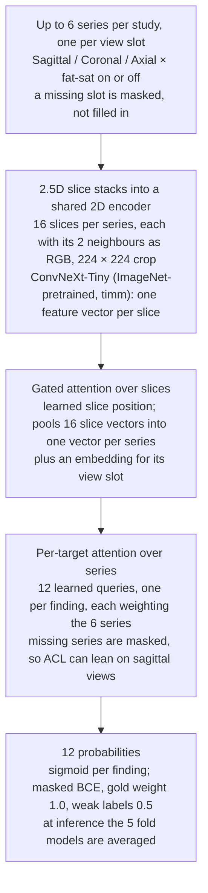

# RSNA Knee Abnormality Detection: Project Manifesto

As of 2026-10-07. This is a snapshot of the project manifesto doc; the chart and diagram there are rendered here as
a table and a Mermaid flowchart.

## Mission

We are building a model that reads a knee MRI and scores 12 abnormalities, for the
[RSNA Knee Abnormality Detection](https://www.kaggle.com/competitions/rsna-knee-abnormality-detection/overview)
Kaggle competition, which closes on 2026-10-22. The working pipeline runs end to end on a home PC. Its first honest
score is a macro AUC of 0.554, and the next gain must come from labels, not from the model.

- **Task:** for each test study, output a probability for ACL, MCL, Medial Meniscus, Lateral Meniscus, Medial OA,
  Lateral OA, PF OA, Effusion, Synovitis, Baker's cyst, Contusion and Fracture.
- **Metric:** the mean of the 12 per-target ROC AUCs (macro AUC); 0.5 is chance.
- **Format:** a code competition. Predictions run in an offline Kaggle notebook on hidden test studies, which have
  images but no reports.
- **Stakes:** a $77,000 prize pool from the
  [RSNA](https://www.rsna.org/artificial-intelligence/ai-image-challenge/knee-mri-ai-challenge), more than 5,000
  exams from 19 sites, reports in about a dozen languages.

### Progress so far

| Date | Milestone | Result |
| --- | --- | --- |
| 2026-10-07 | 5-fold gold-only baseline trained | OOF macro AUC 0.554 |
| 2026-10-06 | Local-LLM weak-label pilot on the 58 gold reports | Gemma 4 12B agrees at AUC 0.851 |
| 2026-09-24 | Inference tested on the 3 local test studies | submission.csv matches the sample format |
| 2026-09-24 | 2.5D multi-view model, training and inference code written | smoke run: loss falls, 3.3 GB GPU peak |
| 2026-09-24 | 500-study subset built and preprocessed | 2,778 series, 0 failures |
| 2026-09-24 | ROCm PyTorch running on the RX 9060 XT | torch 2.13.0+rocm10.0.0 |
| 2026-09-24 | Competition data explored | only 58 of 4,407 studies labelled |

## What the data really is

Only 58 of the 4,407 training studies carry labels. The other 4,349 have just a free-text radiology report, and the
test set has no reports at all. That one fact shapes the whole project: reports can only be used to make training
labels.

| File | What it holds | Size |
| --- | --- | --- |
| train.csv | StudyInstanceUID, Report, 12 target columns | 4,407 studies; 58 with all 12 labels |
| train_series.csv | one row per series: plane, Fluid_Sensitive, Fat_Suppression | 24,371 series, 4 to 14 per study |
| train_series/ | DICOMs as study/series/*.dcm | about 20 to 40 slices a series, about 60 MB a study, about 260 GB in all |
| test.csv, test_series.csv | test IDs and series metadata only | 3 placeholder studies locally; the real test set is hidden |
| sample_submission.csv | StudyInstanceUID + 12 probabilities | format reference |

- **Series types:** six combinations of plane (sagittal, coronal, axial) and fat suppression. Fluid_Sensitive always
  equals Fat_Suppression, so it adds no information.
- **Metadata is reliable:** on the subset, the CSV plane matched the DICOM orientation tags for all 2,778 series.
- **Reports:** written in at least 9 languages; English is the largest group (1,736 studies), then Spanish, Turkish,
  Croatian and Greek.
- **Gold labels look image-based**, with severity thresholds, so labels read from reports are noisy proxies for them.
- **The unzip was once interrupted:** one partial DICOM was deleted, so every loader tolerates missing or unreadable
  files.

## The development subset

A 500-study subset (11% of the training set) holds all 58 gold-labelled studies plus 442 others that mirror the full
set's mix, so ideas can be tried in minutes instead of hours.

1. **Pick:** keep all 58 gold studies; draw 442 more at random within strata of report language × series count
   (seed 42), skipping any study with a missing or empty DICOM folder (none were).
2. **Link:** rebuild the Kaggle folder layout from NTFS hard links, so the subset costs no extra disk on E:.
3. **Fold:** split into 5 folds of 99 to 101 studies, each holding 11 or 12 gold studies.
4. **Preprocess:** read each series, sort slices along the slice normal, pad to square, resample to 32 × 256 × 256,
   clip to the 0.5 to 99.5 percentile and save as uint8 .npy (about 5 GB, 22 minutes, 0 failures).
5. **Check:** a montage of random series confirmed correct slice order and contrast.

The subset lives in `E:\Documents\Projects\data\subset\` (train.csv, train_series.csv, folds.csv, train_series/,
volumes/). It has 2,778 series; sagittal non-fat-suppressed is the most common type (597) and axial
non-fat-suppressed the rarest (136). The same `load_volume` function is reused unchanged at inference.

## Running on an AMD GPU

Training runs natively on Windows on the AMD Radeon RX 9060 XT (gfx1200, 16 GB) through AMD's ROCm build of PyTorch;
no cloud GPU is needed.

| Component | Version or setting |
| --- | --- |
| Python | 3.13, venv at `rsna-knee\.venv` |
| PyTorch | 2.13.0+rocm10.0.0 (torchvision 0.28.0), from AMD's `stable.repo.amd.com/rocm/whl-next/` index with the `device-gfx1200` extra |
| GPU API | ROCm appears as `cuda` in PyTorch; `torch.cuda.get_device_name(0)` returns the RX 9060 XT |
| Precision | bf16 autocast, verified with a matmul on the device |
| Other libraries | pandas, pydicom, pylibjpeg, timm, scikit-learn, langdetect, opencv-python-headless, matplotlib |

The first epoch after a fresh start is slow (90 to 378 s) while ROCm compiles its kernels; after that an epoch over 46
studies takes 37 to 42 s. Models are plain PyTorch, so the same checkpoints run on Kaggle's NVIDIA GPUs. Install
guide: [AMD ROCm PyTorch](https://rocm.docs.amd.com/projects/ai-ecosystem/en/latest/frameworks/pytorch/install.html).

## The model and pipeline

KneeNet is a 2.5D multi-view attention model: one shared 2D network reads the slices, and each of the 12 findings
learns its own weighting of the MRI views.

Training uses AdamW (2e-4 for the heads, 5e-5 for the backbone, weight decay 0.05), a cosine schedule with 1 warm-up
epoch, batches of 2 studies with 4-step accumulation, bf16 and gradient checkpointing. Augmentation is a random crop,
gamma and brightness jitter; there are no flips, because a flip would swap medial and lateral anatomy and make those
labels wrong.

| File | Role |
| --- | --- |
| `src/common.py` | the 12 target names and the 6 view slots |
| `src/make_subset.py` | stratified subset, hard links, 5 folds |
| `src/preprocess.py` | DICOM series to a 32 × 256 × 256 uint8 volume; montage check |
| `src/labels.py` | gold labels plus optional weak labels, with a weight per study |
| `src/weak_labels.py` | report labelling with a local LLM: run, eval, export |
| `src/dataset.py` | one series per slot, 2.5D stacks, augmentation |
| `src/model.py` | KneeNet |
| `src/train.py` | k-fold training, resume, out-of-fold metrics |
| `src/infer.py` | fold ensemble to submission.csv; runs offline on Kaggle |
| `configs/base.yaml` | every hyperparameter and path |

## Weak labels from reports

A local LLM reading the reports already agrees with the gold labels at a macro AUC of 0.851 (Gemma 4 12B), far above
the image model's 0.554, so report-derived labels for the 4,349 unlabelled studies are the next lever.

We chose a local open model over a cloud API so the competition reports never leave this PC. The script
`src/weak_labels.py` has three commands (run, eval, export) and caches each model's answers in a resumable
`data/weak_labels/<tag>.jsonl`. Models run in llama.cpp (Vulkan build b11445) on the same GPU.

| Model | Quantisation | Gold reports done | Macro AUC vs gold | Speed |
| --- | --- | --- | --- | --- |
| Gemma 4 12B | Q5_K_M | 58 of 58 | 0.851 | about 5.3 reports a minute |
| Qwen 3.5 9B | Q6_K | 24 of 58 | not yet scored | |
| Gemma 4 26B-A4B | UD-IQ3_S, 11.3 GB | not started | | |

Gemma 12B's weakest targets are Synovitis (0.73) and Contusion (0.72). At 5.3 reports a minute, labelling all 4,407
studies would take about 14 hours, so speed matters as much as accuracy. In training, the weak labels plug into
`src/labels.py` as soft targets with weight 0.5, against 1.0 for gold.

## Baseline results

Trained on gold labels only, the model scores an out-of-fold macro AUC of 0.554: proof that the pipeline works, not
yet a model that sees much. Only Medial OA clearly beats chance.

| Target | OOF ROC AUC |
| --- | --- |
| Medial OA | **0.712** |
| Effusion | 0.615 |
| Lateral OA | 0.609 |
| Lateral Meniscus | 0.607 |
| Synovitis | 0.570 |
| PF OA | 0.550 |
| Medial Meniscus | 0.529 |
| Baker's cyst | 0.507 |
| ACL | 0.500 |
| Contusion | 0.497 |
| MCL | 0.476 |
| Fracture | 0.476 |
| **Macro** | **0.554** |

Each fold trained convnext_tiny for 15 epochs on 46 gold studies and validated on 12 (about 42 s an epoch). The best
epochs scored 0.59 to 0.77 on their own validation studies, but those numbers are optimistic because the epoch was
picked on the same 12 studies. ACL, MCL, Baker's cyst, Contusion and Fracture sit at chance. Checkpoints,
out-of-fold predictions and metrics are in `rsna-knee/runs/base/` (kept local, not in git).

## Lessons from the machine

With 16 GB of system RAM and a mechanical data drive, memory and disk, not the GPU, set the limits; training now runs
in a single process and peaks at 3.6 GB of GPU memory.

| Problem | What we saw | Fix |
| --- | --- | --- |
| DataLoader workers on Windows | each worker loads its own PyTorch and ROCm, 0.7 to 1.2 GB; free RAM fell to 750 MB at a fold change and the first full run was killed | `num_workers: 0`; free RAM rose to 8 GB, epochs about 10% slower (37 to 41 s) |
| Lambdas in the dataset | Windows workers start by spawn and could not pickle the loader | `npy_loader` became a small class |
| Restarting a long run | an interrupted 5-fold run lost finished folds | `resume: true` reuses any `fold<k>.pt` and only recomputes its predictions |
| llama.cpp defaults | an 8 GB prompt cache, context checkpoints and a memory-mapped model filled RAM; prompts ran about 50× slower | always pass `--cache-ram 0 --ctx-checkpoints 0 --load-mode none` |
| E: is an HDD | model loads take minutes; the first pass over the volumes is slower | keep data on E: (C: is nearly full) and let the file cache warm up |
| Background apps | Discord, Steam, Epic and Razer used about 1.4 GB | close them before long runs |

## Principles and next steps

The plan to the 2026-10-22 deadline is labels first, then scale: label every report, retrain against the 0.554
baseline, then train on all 4,407 studies and submit.

**Principles we hold to**

- **The 58 gold studies are the only yardstick.** Scores are out-of-fold over all 58; a best epoch picked on the same
  12 studies is not a result.
- **Reports stay on this PC.** Labelling uses local models; no report text goes into logs, docs or the repository.
- **No competition data leaves the machine.** The repository holds code and configs only; checkpoints and data stay
  local.
- **One preprocessing path.** `load_volume` is shared by training and the Kaggle notebook.
- **Portable models.** Plain PyTorch and timm, so AMD-trained weights run on Kaggle's NVIDIA GPUs.

**Next steps, in order**

- [ ] Finish the pilot: Qwen 3.5 9B (34 gold reports left) and Gemma 4 26B-A4B
- [ ] Pick the labelling model, weighing agreement with gold against speed
- [ ] Speed up the llama.cpp server (try the ROCm build, shorter JSON keys, prefix reuse); 14 hours is the current
      estimate
- [ ] Label all 4,407 reports and export a weak-label CSV
- [ ] Retrain the subset with `weak_labels` set and a new `out_dir`; compare against 0.554
- [ ] Preprocess all 4,407 studies (about 3 hours) and train on the full set
- [ ] Build the offline Kaggle notebook: upload `src/` and the fold checkpoints as a Kaggle Dataset, run `infer.py`,
      submit
- [ ] Push the code to a private GitHub repository
